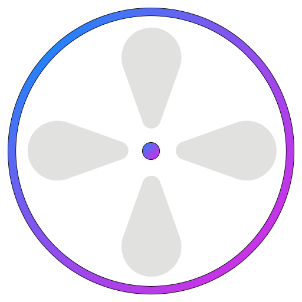

# ReCon

A Resonite Contacts App

[Get it here](https://github.com/Nutcake/ReCon/releases/latest)

## Building

This is a standard Flutter application, refer to the [Flutter docs](https://docs.flutter.dev/get-started/install) on how to build it.

Currently only Android is fully supported.

The app works on other platforms, though not every feature will be functional.
For example, notifications are currently not supported on non-android builds.

## Screenshots
   
